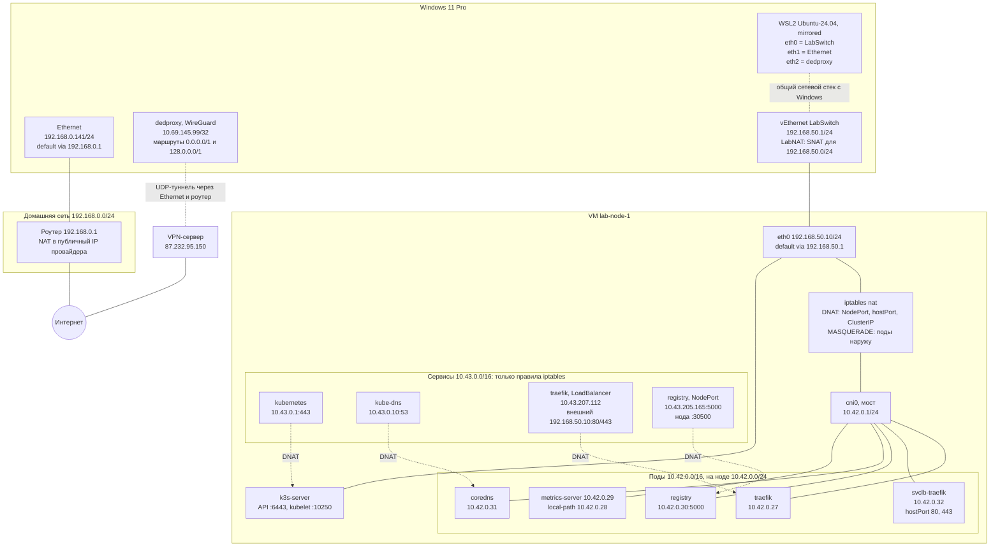

# Сеть стенда

Схема сети homelab-стенда: Windows 11 + WSL2 (mirrored) + Hyper-V VM `lab-node-1` с k3s.
Данные собраны на неделе 1 (`ip -br a`, `ip r`, `Get-NetIPAddress`, `traceroute`, `kubectl`).

> IP подов меняются при каждом пересоздании подов (например, после перезагрузки VM).
> Актуальные значения: `kubectl get pods -A -o wide`. Стабильны только IP сервисов (ClusterIP).

## Общая схема



Сплошные линии — реальные интерфейсы и связи. Пунктир — логические связи:
- адреса сервисов `10.43.x.x` не висят ни на одном интерфейсе;
- kube-proxy превращает их в правила DNAT на IP подов.

## Подсети

| Подсеть | Где | Назначение |
|---|---|---|
| `192.168.0.0/24` | домашний роутер | физическая сеть, ПК = `.141`, шлюз = `.1` |
| `10.69.145.99/32` | WireGuard `dedproxy` | адрес туннеля VPN |
| `192.168.50.0/24` | Hyper-V `LabSwitch` + `LabNAT` | сеть VM: Windows = `.1`, `lab-node-1` = `.10` |
| `172.28.112.0/20` | Hyper-V Default Switch | не используется |
| `10.42.0.0/16` | k3s, flannel | сеть подов; нода получает `/24`, у `lab-node-1` — `10.42.0.0/24` |
| `10.43.0.0/16` | k3s, kube-proxy | ClusterIP сервисов (виртуальные адреса) |

## Маршрутизация: longest prefix match

Из всех подходящих маршрутов выбирается самый конкретный, то есть с самой длинной маской.

VPN-клиент добавляет два маршрута `/1`:
- `0.0.0.0/1` и `128.0.0.0/1` вместе покрывают все адреса;
- оба конкретнее, чем `0.0.0.0/0`;
- поэтому, пока VPN включён, маршрут по умолчанию через роутер не выбирается.

Отдельный маршрут `87.232.95.150 via 192.168.0.1` ведёт к самому VPN-серверу через роутер. Без него пакеты туннеля пытались бы уйти в этот же туннель.

| Назначение | Выигравший маршрут | Куда уходит |
|---|---|---|
| `192.168.50.10` (VM) | `192.168.50.0/24` | напрямую в LabSwitch |
| `192.168.0.1` (роутер) | `192.168.0.0/24` | напрямую в Ethernet |
| `8.8.8.8` | `0.0.0.0/1` | в VPN |

Следствие: при включённом VPN в туннель уходит и интернет-трафик VM и подов.

`traceroute -n 8.8.8.8` из VM:

```
1  192.168.50.1     0.2 мс   Windows: шлюз и LabNAT
2  10.79.255.254   72 мс     другая сторона VPN-туннеля
3  87.232.95.1     72 мс     сеть VPN-сервера
```

Роутер `192.168.0.1` в трассировке не виден: он передаёт зашифрованные пакеты туннеля.

## Пути пакета

### 1. WSL → registry по NodePort (`docker push 192.168.50.10:30500/...`)

```
WSL (сетевой стек Windows)
  → маршрут 192.168.50.0/24 → LabSwitch
  → VM eth0, порт 30500
  → iptables nat PREROUTING, KUBE-NODEPORTS
      DNAT 192.168.50.10:30500 → 10.42.0.30:5000
  → маршрут 10.42.0.0/24 → мост cni0 → veth
  → под registry
ответ: conntrack возвращает исходный адрес и порт
```

### 2. WSL → Traefik (`http://api.lab.local`)

```
hosts: api.lab.local → 192.168.50.10
  → VM eth0, порт 80
  → iptables: правило kube-proxy для внешнего IP LoadBalancer
    (или CNI hostPort от svclb)
      DNAT → под traefik
  → Traefik маршрутизирует по Ingress (появится на неделе 2)
```

Порт 80 на ноде не слушает ни один процесс (`ss -ltnp` пусто): трафик перехватывает DNAT раньше, чем ядро ищет сокет.

### 3. Под → под

```
напрямую по IP:   traefik 10.42.0.27 → мост cni0 → registry 10.42.0.30   (без NAT)
через Service:    10.43.205.165:5000 → DNAT kube-proxy → 10.42.0.30:5000
по DNS:           registry.registry.svc.cluster.local → CoreDNS (10.43.0.10) → 10.43.205.165
```

### 4. Под → интернет (три NAT)

```
под 10.42.0.x
  → шлюз пода 10.42.0.1 (cni0)
  → VM: MASQUERADE (flannel), источник → 192.168.50.10
  → eth0 → Windows LabSwitch
  → LabNAT: источник → адрес исходящего интерфейса Windows
      VPN включён:  10.69.145.99 → WireGuard → VPN-сервер → интернет
      VPN выключен: 192.168.0.141 → роутер (NAT в публичный IP) → интернет
```

## Известные проблемы

### WSL без сети после перезагрузки

Симптомы:
- `Network is unreachable`;
- в `ip -br a` только `lo`;
- при старте WSL пишет `Не удалось настроить сеть (networkingMode Mirrored)`.

Причина: WireGuard `dedproxy` поднимается раньше WSL и ломает mirrored-режим.

Решение:
1. Отключить VPN.
2. Выполнить `wsl --shutdown` и заново открыть WSL.
3. Снова включить VPN.

### IP подов меняются

После перезагрузки VM все поды получили новые адреса (registry: `10.42.0.11` → `10.42.0.30`).

Обращаться к подам только через Service или DNS-имя сервиса. kube-proxy обновляет правила DNAT автоматически.

## Как проверить

```bash
# Windows (PowerShell)
Get-NetIPAddress -AddressFamily IPv4 | Select-Object InterfaceAlias, IPAddress, PrefixLength
Get-NetNat

# WSL / VM
ip -br a
ip r
ip link show master cni0            # veth подов на мосту (VM)
traceroute -n -m 6 8.8.8.8

# Kubernetes
kubectl get pods -A -o custom-columns=NS:.metadata.namespace,NAME:.metadata.name,IP:.status.podIP
kubectl get svc -A
sudo iptables -t nat -S | grep -E 'KUBE-NODEPORTS|CNI-HOSTPORT-DNAT'
```
